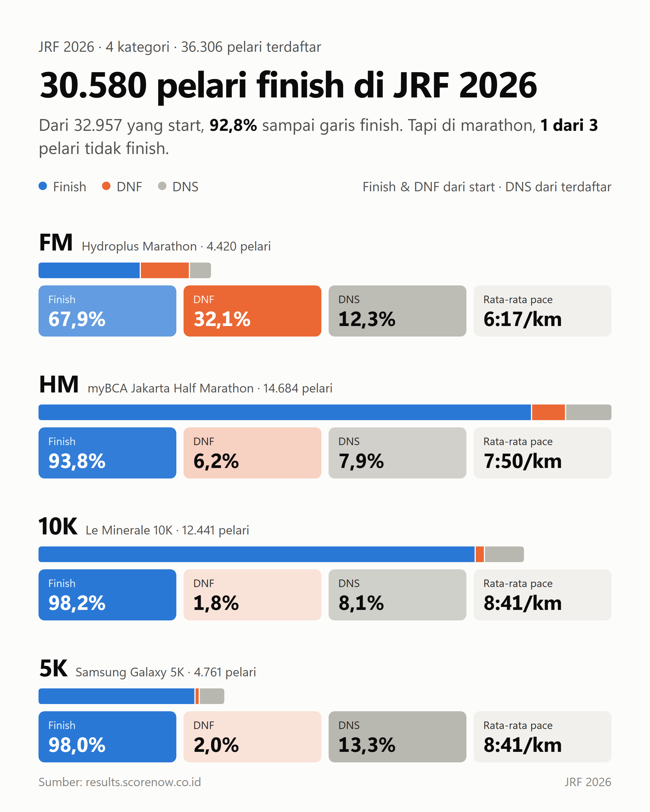
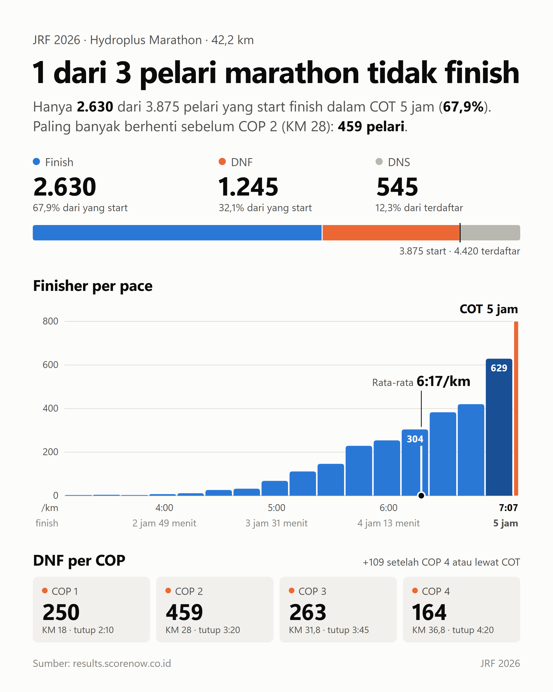
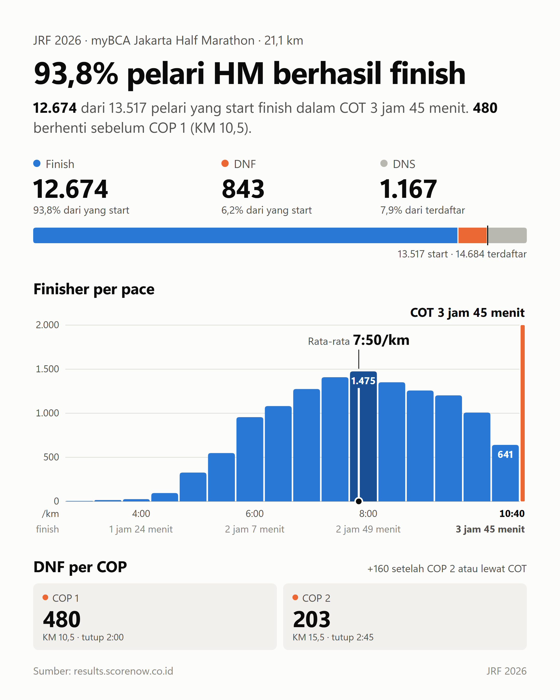
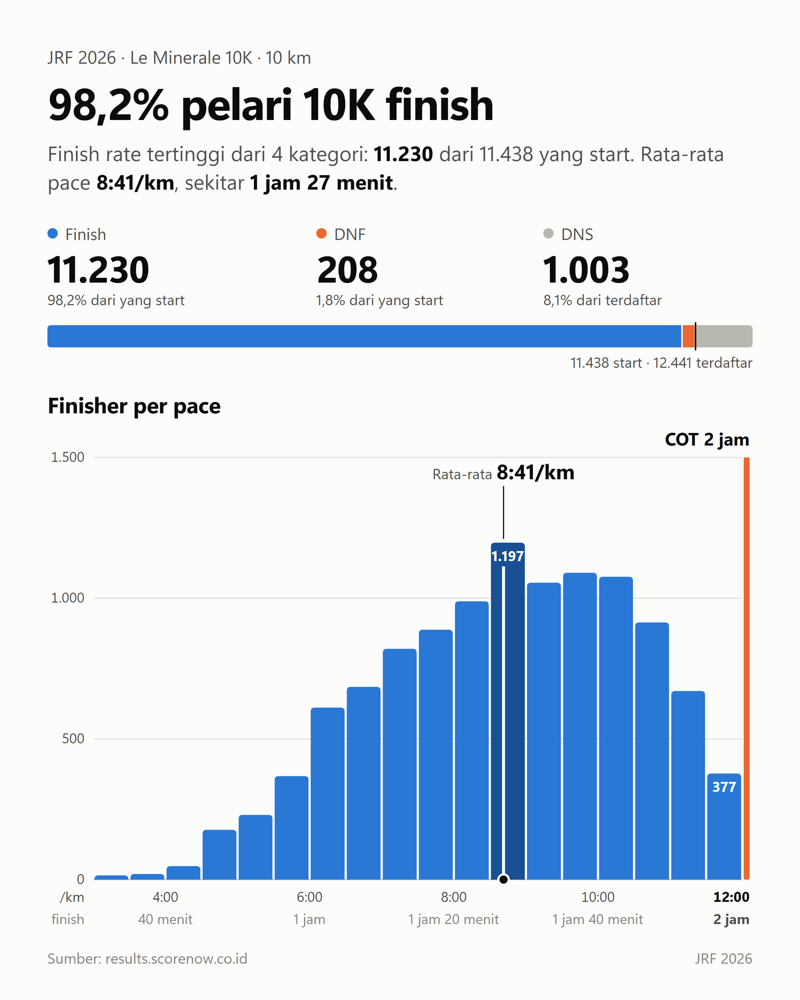
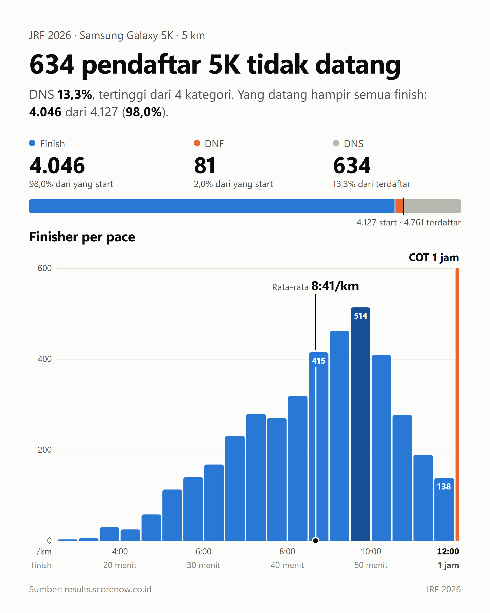
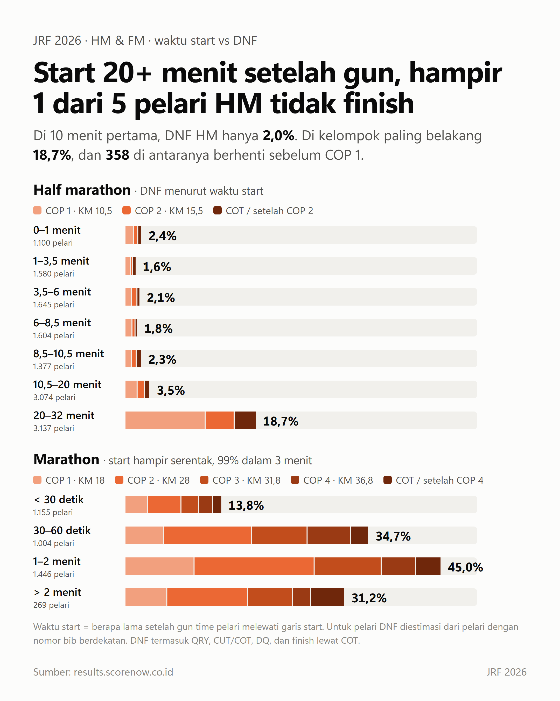
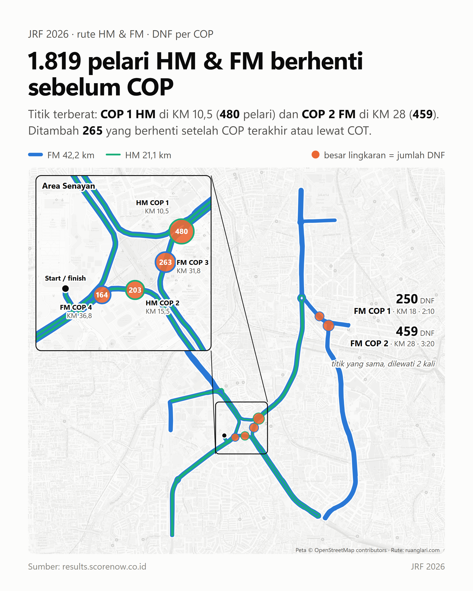
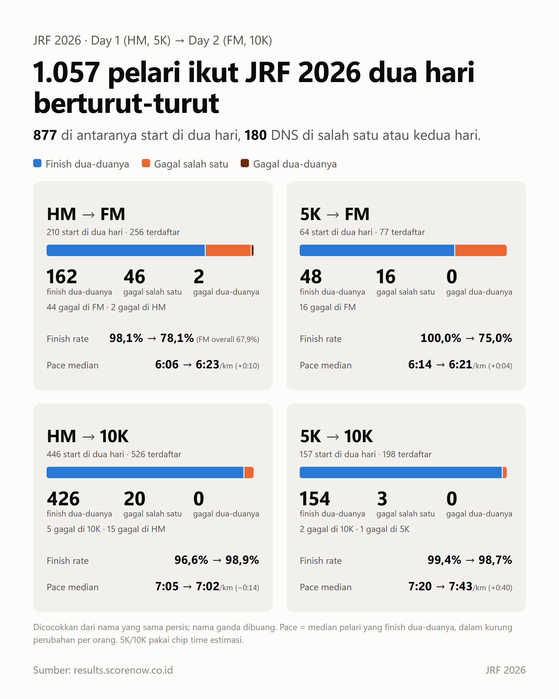

# JRF 2026 Stats

Statistik hasil lomba **Jakarta Running Festival (JRF) 2026** untuk empat kategori: Hydroplus Marathon (FM), myBCA Jakarta Half Marathon (HM), Le Minerale 10K, dan Samsung Galaxy 5K. Isinya delapan chart portrait 4:5 (2160 × 2700) yang siap diposting di Threads, script untuk membuat ulang chart-chart itu, dan dataset CSV-nya.

| | | | |
|---|---|---|---|
|  |  |  |  |
|  |  |  |  |

Teks posting dan alt text untuk tiap gambar ada di [`charts/jrf2026_threads_caption.md`](charts/jrf2026_threads_caption.md).

## Isi repo

- `charts/`: delapan chart dan teks caption Threads.
- `data/`: hasil lomba yang di-scrape dari [results.scorenow.co.id](https://results.scorenow.co.id).
- `scripts/`: generator chart.
  - `build_social.py`: chart 1–5 (ringkasan dan per kategori).
  - `dnf_stats.py` dan `build_dnf_pages.py`: chart 6–7 (waktu start vs DNF, peta rute dengan DNF per COP).
  - `build_double.py`: chart 8 (pelari yang ikut Day 1 dan Day 2).
  - `fetch_routes.py`: unduh rute HM dan FM dari ruanglari.com.
  - `render.py`: render HTML ke PNG dengan headless Chrome.
  - `build_all.py`: jalankan semuanya sekaligus.

## Data

| File | Baris | Isi |
|---|---|---|
| `hydroplus_marathon_JRF2026_results.csv` | 4.420 | FM, daftar hasil: posisi, bib, nama, waktu, kategori, gender, negara, split |
| `mybca_jakarta_half_marathon_JRF2026_results.csv` | 14.684 | HM, daftar hasil |
| `le_minerale_10k_JRF2026_results.csv` | 12.441 | 10K, daftar hasil |
| `samsung_galaxy_5k_JRF2026_results.csv` | 4.761 | 5K, daftar hasil |
| `hydroplus_marathon_JRF2026_results_chiptime.csv` | 4.420 | FM dari halaman detail tiap pelari: status, gun time, chip time, start offset, split kumulatif |
| `mybca_jakarta_half_marathon_JRF2026_results_chiptime.csv` | 14.684 | HM dari halaman detail tiap pelari, kolom sama dengan file FM |

Beberapa hal yang perlu diketahui:

- Di file daftar hasil, kolom `Time` adalah gun time. Pelari tanpa waktu resmi punya kode status yang menempel di depan nama (`CUT`, `QRY`, `DQ`); script membuang kode itu sebelum mencocokkan nama.
- Kolom split di file daftar hasil FM dan HM tidak bisa dipakai sebagai waktu segmen. Untuk FM dan HM, pakai file `_chiptime`.
- Di file `_chiptime`, start offset dan gun/chip time hanya ada untuk pelari yang finish.

## Definisi

- **Finish**: punya waktu resmi (gun time) di dalam COT: FM 5 jam, HM 3 jam 45 menit, 10K 2 jam, 5K 1 jam.
- **DNF**: start tapi tidak finish resmi. Termasuk status DNF / Start and Running, QRY, CUT/COT, DQ, dan gun time lewat COT.
- **DNS**: terdaftar tapi tidak start.
- **DNF per COP**: pelari DNF dihitung di COP pertama setelah split terakhir yang tercatat.
- **Waktu start**: berapa lama setelah gun time pelari melewati garis start. Untuk pelari yang tidak finish, nilainya diestimasi dari pelari finish dengan nomor bib berdekatan.
- **Pelari dua hari**: Day 1 (HM, 5K) dan Day 2 (FM, 10K) dicocokkan dari nama yang sama persis. Nama yang dipakai lebih dari satu pelari dibuang.
- **Chip time 5K dan 10K**: diestimasi dari split segmen, karena data chip resmi hanya ada untuk FM dan HM.

## Cara membuat ulang chart

Butuh Python 3.10+, Chrome/Edge/Chromium (atau set variabel `CHROME` ke path browser), dan koneksi internet untuk rute dan peta dasar.

```bash
pip install -r requirements.txt
python scripts/build_all.py
```

Hasilnya ada di `out/`.

## Sumber

- Hasil lomba: [results.scorenow.co.id](https://results.scorenow.co.id)
- Rute HM dan FM: [ruanglari.com](https://ruanglari.com/gpx/jrf-marathon-2026-full-marathon)
- Peta dasar: © [OpenStreetMap contributors](https://www.openstreetmap.org/copyright)

## Lisensi

- **Script** (`scripts/`): [MIT](LICENSE).
- **Chart dan teks caption** (`charts/`): [CC BY 4.0](charts/LICENSE). Boleh dipakai ulang dan diubah, termasuk untuk keperluan komersial, asal mencantumkan kredit "Nigel Immanuel / JRF2026-stats". Peta dasar di chart 7 adalah © OpenStreetMap contributors (data ODbL); kredit itu harus tetap ada.
- **Dataset** (`data/`): berasal dari [results.scorenow.co.id](https://results.scorenow.co.id) dan tidak termasuk kedua lisensi di atas. Lihat [`data/README.md`](data/README.md).
